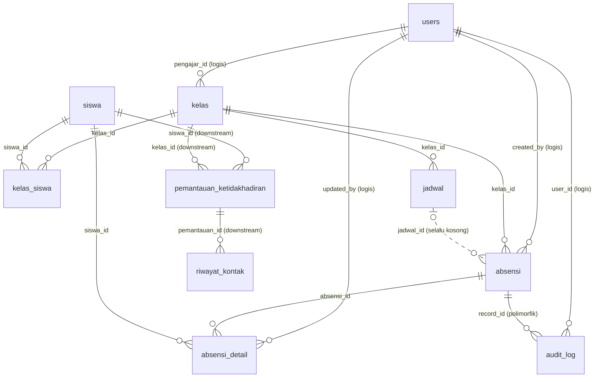

# Relasi Data Absensi Kelas (Admin)

Status: hasil penelusuran kode, tanpa perubahan kode/data/skema.
Tanggal penelusuran: 2026-11-27.
Sumber utama: kode aktual di `src/` dan definisi skema di `src/lib/sheet-schema.js`.
Data Google Spreadsheet aktual tidak dibaca pada penelusuran ini; lihat bagian 8.

## 1. Ringkasan alur pembuatan absensi

Route yang benar-benar dipakai:

- Halaman input: `/admin/absensi/tambah`
- File: `src/app/admin/absensi/tambah/page.js`
- Komponen server: `TambahAbsensiPage`
- Server action penyimpanan: `simpanAbsensi` (didefinisikan di file yang sama)
- Guard akses: `src/app/admin/layout.js` (`AdminLayout`) mewajibkan `session.user.role === "Admin"` dan `accountStatus === "active"`, jika tidak redirect ke `/login`.

Alur singkat:

1. Admin memilih kelas aktif. Kelas dibaca dari sheet `kelas`, difilter `status_kelas === "aktif"` di memori, lalu diurutkan berdasarkan `nama_kelas`.
2. Kelas terpilih ditentukan dari query string: `kelas_id` (utama), fallback `kelasId`. Form pemilih kelas mengirim nama field `kelasId`.
3. Daftar siswa diambil dari `kelas_siswa` yang `status_keanggotaan === "aktif"` untuk `kelas_id` terpilih, lalu di-join ke `siswa` lewat `siswa_id`.
4. Admin mengisi `tanggal`, `jam_mulai`, `jam_selesai`, `topik`, status kehadiran per siswa, dan catatan per siswa.
5. `simpanAbsensi` menulis satu baris `absensi` berstatus `final`, satu baris `audit_log` aksi `create`, lalu satu baris `absensi_detail` per siswa yang ada di daftar saat halaman dirender.
6. Redirect ke `/admin/absensi/{absensi_id}`.

Fakta penting:

- `status_absensi` selalu dipaksa `"final"` oleh repository, bukan hanya oleh halaman. Bukti: `src/repositories/absensi-repository.js`, `validateCreate` memanggil `validateFields({ ...data, status_absensi: 'final' }, ...)`; `ABSENSI_STATUSES = ['final']` di `src/lib/domain-constants.js`.
- `jadwal_id` selalu dikirim sebagai string kosong `""` dari halaman input. Bukti: `simpanAbsensi` di `src/app/admin/absensi/tambah/page.js`.
- Jadwal hanya dipakai untuk nilai awal (`defaultValue`) `jam_mulai`; tidak ada `jadwal_id` yang disimpan dan tidak ada validasi terhadap jadwal.
- `kelas.pengajar_id` tidak dibaca sama sekali oleh halaman input. Penugasan pengajar tidak memengaruhi pembuatan absensi.
- Tidak ada pengecekan absensi ganda untuk kombinasi kelas/tanggal/jam. `absensi` tidak memiliki `uniqueKeys`.

## 2. Diagram relasi data

Relasi di bawah adalah relasi logis berbasis nilai kolom. Tidak ada foreign key yang ditegakkan oleh Google Sheets maupun repository.

Catatan diagram:

- `jadwal_id` ada di skema `absensi`, tetapi alur input selalu menulis `""`, sehingga relasi jadwal ke absensi tidak terbentuk pada data baru.
- `pemantauan_ketidakhadiran` dan `riwayat_kontak` bukan bagian dari proses input absensi. Keduanya dibuat dari halaman `hubungi-pengajar` berdasarkan data absensi final 30 hari.
- `audit_log.record_id` bersifat polimorfik: diisi `absensi_id` untuk audit absensi, bukan foreign key.

## 3. Entitas, kolom, dan relasi

Definisi kolom diambil dari `src/lib/sheet-schema.js` (`WORKSHEET_SCHEMAS`). Prefix ID dari `ID_PREFIXES`.

| Entitas / sheet | Kolom yang dibaca | Kolom yang ditulis | PK | Relasi logis | Wajib untuk membuat absensi? | Operasi saat input |
|---|---|---|---|---|---|---|
| `kelas` | `kelas_id`, `kode_kelas`, `nama_kelas`, `kapasitas`, `status_kelas` | - | `kelas_id` (`KLS`) | `kelas_siswa.kelas_id`, `jadwal.kelas_id`, `absensi.kelas_id`, `pemantauan_ketidakhadiran.kelas_id` | Ya. Hanya kelas dengan `status_kelas === "aktif"` yang bisa dipilih | Baca |
| `kelas_siswa` | `kelas_id`, `siswa_id`, `status_keanggotaan` | - | `kelas_siswa_id` (`KRS`) | `kelas.kelas_id`, `siswa.siswa_id` | Ya, untuk menentukan daftar siswa. Jika tidak ada membership aktif, form menampilkan "Belum ada siswa aktif di kelas ini." | Baca |
| `siswa` | `siswa_id`, `nama`, `nis` | - | `siswa_id` (`SIS`) | `kelas_siswa.siswa_id`, `absensi_detail.siswa_id` | Ya, untuk menampilkan identitas siswa. Membership tanpa baris `siswa` yang cocok akan dibuang (`.filter(Boolean)`) | Baca |
| `jadwal` | `kelas_id`, `jam_mulai` | - | `jadwal_id` (`JDL`) | `kelas.kelas_id` | Tidak wajib. Hanya untuk prefill `jam_mulai` | Baca |
| `absensi` | - | `absensi_id`, `kelas_id`, `jadwal_id`, `tanggal`, `jam_mulai`, `jam_selesai`, `topik`, `status_absensi`, `created_by`, `created_at`, `updated_at` | `absensi_id` (`ABS`) | `kelas.kelas_id`, `users.user_id` (`created_by`), `jadwal.jadwal_id` (kosong) | Ya, baris utama sesi | Tulis |
| `absensi_detail` | - | `absensi_detail_id`, `absensi_id`, `siswa_id`, `status_kehadiran`, `catatan`, `updated_by`, `updated_at` | `absensi_detail_id` (`ABD`) | `absensi.absensi_id`, `siswa.siswa_id`, `users.user_id` (`updated_by`) | Ya, satu baris per siswa yang dikirim form | Tulis |
| `users` | `user_id`, `name` (di halaman detail) | - | `user_id` (`USR`) | `kelas.pengajar_id`, `absensi.created_by`, `absensi_detail.updated_by`, `audit_log.user_id` | Ya secara praktis: `created_by` dan `updated_by` required; nilai diambil dari `session.user.id` | Baca (identitas admin) |
| `audit_log` | - | `audit_id`, `user_id`, `aksi`, `nama_tabel`, `record_id`, `data_sebelum`, `data_sesudah`, `keterangan`, `created_at` | `audit_id` (`AUD`) | `users.user_id`, `record_id` polimorfik ke `absensi.absensi_id` | Tidak wajib untuk validasi, tetapi selalu ditulis oleh halaman | Tulis |
| `pemantauan_ketidakhadiran` | `siswa_id`, `kelas_id`, `tanggal_mulai`, `tanggal_selesai`, `jumlah_alpa_terakhir`, `status_pemantauan` | - | `pemantauan_id` (`PMN`) | `siswa`, `kelas` | Tidak. Downstream, dibuat dari `hubungi-pengajar` | Tidak disentuh |
| `riwayat_kontak` | `pemantauan_id`, `siswa_id`, `kelas_id`, `pengajar_id`, dll. | - | `kontak_id` (`KTK`) | `pemantauan_ketidakhadiran`, `users` | Tidak. Downstream | Tidak disentuh |

Kolom `kelas.pengajar_id` ada dan required di repository `kelas`, tetapi tidak dibaca oleh alur input absensi. Bukti: `src/repositories/kelas-repository.js` mendefinisikan `pengajar_id` required; `src/app/admin/absensi/tambah/page.js` tidak mengakses `pengajar_id`.

Kolom `siswa.status` ada di skema, tetapi tidak difilter saat menentukan daftar siswa. Yang difilter hanya `kelas_siswa.status_keanggotaan === "aktif"`.

## 4. Urutan proses dari halaman input sampai tersimpan

### 4.1 Render halaman

1. `AdminLayout` (`src/app/admin/layout.js`) memanggil `auth()` dan menolak non-Admin/non-aktif.
2. `TambahAbsensiPage` memanggil `connection()` lalu membaca `searchParams`.
3. `selectedKelasId` diambil dari `params.kelas_id`, fallback `params.kelasId`, fallback `""`.
4. `listKelas()` membaca seluruh sheet `kelas`.
5. Filter `status_kelas === "aktif"`, urut `nama_kelas`.
6. `selectedKelas = activeKelas.find(item => item.kelas_id === selectedKelasId)`.
7. `listKelasSiswa()` membaca seluruh `kelas_siswa` untuk menghitung jumlah anggota aktif per kelas (label kapasitas).
8. `listJadwal()` membaca seluruh `jadwal`. `selectedJadwal` = baris pertama dengan `kelas_id === selectedKelas.kelas_id`. Tidak ada filter `status_jadwal`, tidak ada pencocokan `hari`.
9. Jika `selectedKelas` ada:
   - `listKelasSiswaByKelasId(selectedKelas.kelas_id)`
   - filter `status_keanggotaan === "aktif"`
   - `listSiswa()` lalu join lewat `Map(siswa_id -> siswa)`
   - `.filter(Boolean)` membuang membership tanpa siswa
10. Form dirender. Field per siswa memakai nama dinamis:
    - `status_{siswa_id}`
    - `catatan_{siswa_id}`

### 4.2 Submit form

1. Form `action={simpanAbsensi}` mengirim `kelas_id` (hidden), `tanggal`, `jam_mulai`, `jam_selesai`, `topik`, dan field per siswa.
2. `simpanAbsensi` memanggil `auth()`; `session.user.id` dipakai sebagai `created_by`.
3. `createAbsensi(...)`:
   - `createTableRepository.create` → `withTableLock("absensi")`
   - `readAll()` membaca dan memvalidasi seluruh baris `absensi`
   - `nextRecordId("ABS", records, "absensi_id")` menghasilkan ID urutan berikutnya
   - `assertIdAvailable`
   - `buildRecord` mengisi `created_at`/`updated_at` dengan `nowTimestamp()`
   - `assertNoDuplicate` tidak melakukan apa pun karena `uniqueKeys` kosong
   - `appendWorksheetRow("absensi", ...)`
4. `recordAuditCreate` menulis `audit_log`:
   - `aksi = "create"`
   - `nama_tabel = "absensi"`
   - `record_id = absensi_id`
   - `user_id = session.user.id`
   - `data_sesudah = JSON record absensi`
   - `keterangan = "Penambahan absensi dari halaman admin"`
5. Loop `for (const student of students)`:
   - `createAbsensiDetail` per siswa
   - `status_kehadiran` = `formData.get("status_" + siswa_id) || "alfa"`
   - `catatan` = `formData.get("catatan_" + siswa_id) || ""`
   - `updated_by` = `session.user.id`
   - Setiap panggilan melakukan lock + baca seluruh sheet `absensi_detail` + append satu baris.
6. `redirect("/admin/absensi/" + created.absensi_id)`.

### 4.3 Validasi yang benar-benar berjalan

Dari `src/repositories/absensi-repository.js`:

- `kelas_id`: string, required, max 20.
- `jadwal_id`: string, opsional, max 20.
- `tanggal`: date, required.
- `jam_mulai`: time, opsional.
- `jam_selesai`: time, opsional.
- `topik`: string, opsional, max 500.
- `status_absensi`: enum, required, hanya `final`.
- `created_by`: string, required, max 20.
- `validateTimes`: jika `jam_mulai` dan `jam_selesai` sama-sama terisi dan `jam_mulai >= jam_selesai`, lempar `ValidationError`.

Dari `src/repositories/absensi-detail-repository.js`:

- `absensi_id`: string, required, max 20.
- `siswa_id`: string, required, max 20.
- `status_kehadiran`: enum required, nilai `hadir | izin | sakit | alfa`.
- `catatan`: string opsional, max 500.
- `updated_by`: string required, max 20.
- `uniqueKeys: [["absensi_id", "siswa_id"]]` mencegah satu siswa tercatat dua kali dalam satu sesi.
- `absensi_id` dan `siswa_id` tidak boleh diubah lewat update.

Yang tidak divalidasi:

- Keberadaan `kelas_id` di sheet `kelas`.
- Keberadaan `siswa_id` di sheet `siswa`.
- Keberadaan `absensi_id` di sheet `absensi` saat membuat detail.
- Keberadaan `created_by`/`updated_by` di sheet `users`.
- Keberadaan `jadwal_id` di sheet `jadwal`.
- Kesesuaian `tanggal` absensi dengan `kelas_siswa.tanggal_mulai`/`tanggal_selesai`.
- Duplikasi sesi absensi untuk kelas/tanggal/jam yang sama.

## 5. Contoh alur satu absensi kelas

Contoh di bawah adalah ilustrasi struktur data, bukan data dari spreadsheet. ID dan nilai diberi tanda `{...}` atau angka contoh yang jelas hipotetis.

1. Admin membuka:
   `/admin/absensi/tambah?kelasId={KLS-0001}`
2. Sistem membaca baris `kelas` dengan `kelas_id = {KLS-0001}` dan `status_kelas = "aktif"`.
3. Sistem membaca `kelas_siswa` dengan `kelas_id = {KLS-0001}` dan `status_keanggotaan = "aktif"`, misalnya:
   - `{KRS-0001}` → `siswa_id = {SIS-0001}`
   - `{KRS-0002}` → `siswa_id = {SIS-0002}`
4. Sistem membaca `siswa` untuk kedua `siswa_id` dan menampilkan `nis` + `nama`.
5. Sistem membaca `jadwal` pertama untuk `{KLS-0001}`, misalnya `jam_mulai = "08:00"`, lalu mengisinya sebagai nilai awal field `jam_mulai`.
6. Admin mengisi dan submit:

   | Field form | Nilai contoh |
   |---|---|
   | `kelas_id` (hidden) | `{KLS-0001}` |
   | `tanggal` | `2026-11-27` |
   | `jam_mulai` | `08:00` |
   | `jam_selesai` | `09:30` |
   | `topik` | `{topik pertemuan}` |
   | `status_{SIS-0001}` | `hadir` |
   | `catatan_{SIS-0001}` | `""` |
   | `status_{SIS-0002}` | `alfa` |
   | `catatan_{SIS-0002}` | `{alasan}` |

7. Baris `absensi` yang ditulis (kolom aktual):

   | Kolom | Nilai |
   |---|---|
   | `absensi_id` | `{ABS-0001}` (dibuat otomatis) |
   | `kelas_id` | `{KLS-0001}` |
   | `jadwal_id` | `""` |
   | `tanggal` | `2026-11-27` |
   | `jam_mulai` | `08:00` |
   | `jam_selesai` | `09:30` |
   | `topik` | `{topik pertemuan}` |
   | `status_absensi` | `final` |
   | `created_by` | `{USR-0001}` |
   | `created_at` | timestamp saat simpan |
   | `updated_at` | timestamp saat simpan |

8. Baris `audit_log` yang ditulis:

   | Kolom | Nilai |
   |---|---|
   | `audit_id` | `{AUD-0001}` |
   | `idempotency_key` | `""` |
   | `user_id` | `{USR-0001}` |
   | `aksi` | `create` |
   | `nama_tabel` | `absensi` |
   | `record_id` | `{ABS-0001}` |
   | `data_sebelum` | `""` |
   | `data_sesudah` | JSON record `absensi` di atas |
   | `keterangan` | `Penambahan absensi dari halaman admin` |
   | `created_at` | timestamp |

9. Baris `absensi_detail` yang ditulis:

   | `absensi_detail_id` | `absensi_id` | `siswa_id` | `status_kehadiran` | `catatan` | `updated_by` |
   |---|---|---|---|---|---|
   | `{ABD-0001}` | `{ABS-0001}` | `{SIS-0001}` | `hadir` | `""` | `{USR-0001}` |
   | `{ABD-0002}` | `{ABS-0001}` | `{SIS-0002}` | `alfa` | `{alasan}` | `{USR-0001}` |

10. Redirect ke `/admin/absensi/{ABS-0001}`.

Halaman detail lalu membaca:

- `getAbsensiById("{ABS-0001}")` → baris `absensi`
- `listAbsensiDetailByAbsensiId("{ABS-0001}")` → baris `absensi_detail`
- `getKelasById(absensi.kelas_id)` → nama kelas
- `getUserById(absensi.created_by)` → nama pencatat
- `getSiswaById(item.siswa_id)` per detail → NIS/nama siswa

## 6. Halaman, service, repository, dan fungsi yang terlibat

### 6.1 Halaman dan komponen

| Path | Fungsi/komponen | Peran |
|---|---|---|
| `src/app/admin/layout.js` | `AdminLayout` | Guard role Admin dan status akun aktif |
| `src/app/admin/absensi/tambah/page.js` | `TambahAbsensiPage` | Render form input dan definisi server action `simpanAbsensi` |
| `src/app/admin/absensi/page.js` | `DaftarAbsensiPage` | Daftar semua sesi absensi + rekap per siswa |
| `src/app/admin/absensi/[absensiId]/page.js` | `DetailAbsensiPage` | Detail sesi, statistik, daftar siswa |
| `src/app/admin/absensi/[absensiId]/edit/page.js` | `EditAbsensiPage` | Ubah `topik` dan status/catatan detail |
| `src/app/admin/page.js` | `AdminDashboardPage` | Statistik absensi final, termasuk hari ini |
| `src/app/admin/pemantauan/page.js` | `DaftarPemantauanPage` | Hitung alfa 30 hari dari absensi final |
| `src/app/admin/laporan/page.js` | `LaporanPage` | Ringkasan laporan dari absensi + detail |
| `src/app/admin/laporan/kehadiran-siswa/page.js` | `LaporanKehadiranSiswaPage` | Rekap kehadiran per siswa dari absensi final |
| `src/app/admin/laporan/rekap-pembelajaran/page.js` | `RekapPembelajaranPage` | Rekap pembelajaran dari absensi final |
| `src/app/admin/laporan/aktivitas-kelas/page.js` | `AktivitasKelasPage` | Aktivitas kelas dari absensi |
| `src/app/admin/laporan/kehadiran-pengajar/page.js` | `KehadiranPengajarPage` | Kehadiran terkait pengajar/kelas |
| `src/app/admin/laporan/hubungi-pengajar/[pengajarId]/page.js` | halaman kasus + `tandaiSudahDihubungi` | Membuat `pemantauan_ketidakhadiran` dan `riwayat_kontak` dari absensi final 30 hari |
| `src/app/siswa/page.js` | `PencarianSiswaPage` | Pencarian publik; rekap memakai absensi final |
| `src/app/siswa/[siswaId]/page.js` | `SiswaPublikPage` | Riwayat publik; memakai absensi final + filter `periode` |

### 6.2 Repository dan fungsi

| Path | Fungsi | Peran |
|---|---|---|
| `src/repositories/absensi-repository.js` | `createAbsensi` | Validasi + tulis baris `absensi`; memaksa status `final`; melarang ubah `kelas_id` saat update |
| `src/repositories/absensi-repository.js` | `listAbsensi`, `getAbsensiById`, `listAbsensiByKelasId`, `listAbsensiByTanggal` | Baca data absensi |
| `src/repositories/absensi-detail-repository.js` | `createAbsensiDetail` | Validasi + tulis baris `absensi_detail`; unique `[absensi_id, siswa_id]` |
| `src/repositories/absensi-detail-repository.js` | `listAbsensiDetail`, `listAbsensiDetailByAbsensiId`, `listAbsensiDetailBySiswaId`, `updateAbsensiDetail` | Baca/ubah detail |
| `src/repositories/kelas-repository.js` | `listKelas`, `getKelasById` | Baca kelas |
| `src/repositories/kelas-siswa-repository.js` | `listKelasSiswa`, `listKelasSiswaByKelasId`, `findActiveKelasSiswaBySiswaId` | Baca membership; aturan satu membership aktif per siswa |
| `src/repositories/siswa-repository.js` | `listSiswa`, `getSiswaById`, `searchSiswa` | Baca identitas siswa |
| `src/repositories/jadwal-repository.js` | `listJadwal`, `listJadwalByKelasId` | Baca jadwal; tidak memfilter status |
| `src/repositories/audit-log-repository.js` | `recordAuditCreate`, `recordAuditUpdate` | Tulis `audit_log` |
| `src/repositories/sheet-table-repository.js` | `createTableRepository`, `createUnlocked`, `updateUnlocked`, `withTableLock` | Mesin CRUD generik, validasi unique, lock in-process, append/update sheet |
| `src/lib/id-generator.js` | `nextRecordId`, `formatRecordId`, `assertRecordId` | Membuat ID `PREFIX-NNNN` |
| `src/lib/field-validation.js` | `validateFields`, `validateStoredFields` | Validasi tipe/required/enum |
| `src/lib/sheet-schema.js` | `WORKSHEET_SCHEMAS`, `ID_PREFIXES` | Definisi kolom dan prefix ID |
| `src/lib/domain-constants.js` | `ABSENSI_STATUSES`, `KEHADIRAN_STATUSES`, `KELAS_SISWA_STATUSES` | Nilai enum yang diizinkan |
| `src/auth.js` | callback `jwt` dan `session` | Mengisi `session.user.id` dari `users.user_id` |

### 6.3 Perilaku edit

`EditAbsensiPage` (`src/app/admin/absensi/[absensiId]/edit/page.js`):

- `updateAbsensi` mengirim `tanggal`, `jam_mulai`, `jam_selesai` dari nilai sebelumnya, `topik` dari form, dan `status_absensi: "final"`.
- `kelas_id` tidak dikirim; repository tetap melarang perubahan `kelas_id`.
- Loop `updateAbsensiDetail` untuk setiap detail yang sudah ada, mengubah `status_kehadiran`, `catatan`, `updated_by`.
- `absensi_id` dan `siswa_id` pada detail tidak boleh diubah.
- Setelah itu `recordAuditUpdate` hanya untuk `absensi`, bukan untuk `absensi_detail`.
- Halaman edit tidak menambah atau menghapus siswa dari sesi.

## 7. Temuan risiko dan ketidakkonsistenan

Semua temuan dicatat sebagai fakta kode. Tidak ada perbaikan yang dilakukan.

### 7.1 Tidak ada pencegahan absensi ganda per sesi

- `absensi` tidak punya `uniqueKeys`. Bukti: konfigurasi `createTableRepository` di `src/repositories/absensi-repository.js`.
- Tidak ada pengecekan `kelas_id + tanggal + jam_mulai` sebelum `createAbsensi`.
- Akibat: submit dua kali atau dua admin membuat sesi untuk kelas/tanggal yang sama akan menghasilkan dua baris `absensi` berbeda. Rekap bisa menghitung kehadiran dua kali.
- Pencegahan yang ada hanya untuk duplikasi siswa dalam satu sesi lewat `uniqueKeys: [["absensi_id", "siswa_id"]]` di `absensi_detail`.

### 7.2 Tidak ada validasi foreign key

- `createAbsensi` hanya memvalidasi bentuk field, bukan keberadaan `kelas_id`.
- `createAbsensiDetail` tidak memeriksa keberadaan `absensi_id` atau `siswa_id`.
- `created_by`/`updated_by` hanya divalidasi sebagai string required, bukan keberadaan `user_id`.
- Akibat: pemanggilan di luar halaman (script, pemanggilan langsung repository) dapat menulis baris yatim. Halaman input sendiri membatasi kelas ke kelas aktif dan siswa ke membership aktif, tetapi tidak memvalidasi ulang saat submit.

### 7.3 Daftar siswa adalah snapshot saat render

- `students` dihitung di `TambahAbsensiPage` dan dipakai oleh `simpanAbsensi` lewat closure server action.
- Jika membership berubah antara halaman dibuka dan form disubmit, daftar yang disimpan tetap daftar lama.
- Siswa yang baru masuk kelas setelah halaman dirender tidak ikut tercatat. Siswa yang keluar setelah halaman dirender tetap tercatat jika masih ada di form.
- Tidak ada validasi ulang membership saat simpan.

### 7.4 `siswa.status` diabaikan

- Daftar siswa hanya difilter dari `kelas_siswa.status_keanggotaan === "aktif"`.
- Tidak ada filter `siswa.status === "aktif"`.
- Akibat: siswa berstatus `nonaktif` tetap bisa muncul dan dicatat jika membership-nya masih `aktif`.

### 7.5 Rentang tanggal membership diabaikan

- Filter hanya `status_keanggotaan === "aktif"`.
- `tanggal_mulai` dan `tanggal_selesai` tidak dibandingkan dengan `absensi.tanggal`.
- Akibat: absensi untuk tanggal sebelum `tanggal_mulai` atau setelah `tanggal_selesai` tetap bisa dibuat selama status membership masih `aktif`.
- Catatan: repository `kelas_siswa` mewajibkan `tanggal_selesai` kosong untuk status `aktif`, sehingga data normalnya tidak punya tanggal selesai selama aktif.

### 7.6 Jadwal tidak mengikat, `jadwal_id` selalu kosong

- `jadwal` hanya dipakai untuk `defaultValue` `jam_mulai`.
- `selectedJadwal` memakai `.find` baris pertama untuk kelas, tanpa filter `status_jadwal`, tanpa pencocokan `hari`.
- `jadwal_id` selalu dikirim `""` dan tidak ada validasi silang jam terhadap jadwal.
- Akibat: absensi bisa dibuat pada hari/jam yang tidak sesuai jadwal kelas. Relasi `absensi.jadwal_id` tidak pernah terisi dari alur ini.

### 7.7 Pengajar tidak memengaruhi input absensi

- `kelas.pengajar_id` tidak dibaca di `TambahAbsensiPage`.
- Tidak ada pengecekan bahwa admin/pengajar berhak atas kelas tersebut.
- Guard hanya memastikan user ber-role Admin.
- Akibat: Admin mana pun dapat mencatat absensi untuk kelas mana pun.

### 7.8 Tidak ada transaksi

- Urutan tulis: `absensi` → `audit_log` → `absensi_detail` per siswa.
- Setiap penulisan adalah panggilan terpisah ke Google Sheets.
- Jika `audit_log` atau salah satu `absensi_detail` gagal, baris `absensi` sudah terlanjur ada.
- Akibat: bisa terbentuk sesi tanpa audit, atau sesi dengan detail sebagian.
- Tidak ada mekanisme rollback/kompensasi di `simpanAbsensi`.

### 7.9 Audit tidak mencakup detail

- Saat create: hanya `absensi` yang diaudit. `absensi_detail` tidak.
- Saat edit: hanya `absensi` yang diaudit lewat `recordAuditUpdate`. Perubahan `status_kehadiran`/`catatan` per siswa tidak diaudit.
- `idempotency_key` tidak diisi oleh `recordAuditCreate`/`recordAuditUpdate`, sehingga perlindungan duplikasi audit berbasis kunci tidak aktif untuk alur ini.
- Akibat: riwayat perubahan status kehadiran siswa tidak dapat dilacak dari `audit_log`.

### 7.10 Lock hanya in-process

- `withTableLock` menyimpan antrean di `Map` lokal proses (`lockTails` di `src/repositories/sheet-table-repository.js`).
- `nextRecordId` membaca seluruh record lalu menentukan nomor berikutnya, kemudian `appendWorksheetRow` menulis.
- Di lingkungan multi-instance/multi-proses, dua penulisan bersamaan dapat memilih ID yang sama atau menulis sesi ganda.
- Tidak ada bukti mekanisme lock lintas proses di `sheets-repository.js`.

### 7.11 Kinerja baca/tulis

- Setiap `createAbsensiDetail` membaca ulang seluruh sheet `absensi_detail` karena `createTableRepository.create` memanggil `readAll()`.
- Untuk N siswa, terjadi N pembacaan penuh + N append.
- Halaman-halaman laporan juga memanggil `listAbsensi()` dan `listAbsensiDetail()` berulang di beberapa tempat.
- Ini bukan bug fungsional, tetapi berisiko lambat dan rawan kuota Google Sheets saat data bertambah.

### 7.12 Perbedaan sumber kebenaran kelas siswa di hilir

- `absensi` menyimpan `kelas_id` historis.
- `absensi_detail` menyimpan `siswa_id` historis.
- Beberapa halaman menampilkan kelas berdasarkan membership aktif saat ini, bukan `absensi.kelas_id`. Contoh: `src/app/admin/absensi/page.js` membangun `activeMembershipBySiswa` untuk label kelas pada rekap siswa.
- Akibat: jika siswa pindah kelas, rekap per siswa bisa menampilkan kelas saat ini, sementara riwayat absensinya tetap terikat ke `absensi.kelas_id` lama. Ini bisa membingungkan, meskipun bukan kehilangan data.
- Halaman publik `/siswa/[siswaId]` mengambil seluruh detail siswa tanpa memfilter kelas, sehingga riwayat mencakup kelas lama.

### 7.13 Status final langsung tanpa mekanisme draft

- `ABSENSI_STATUSES` hanya berisi `final`.
- Tidak ada alur draft/review. Setiap simpan langsung dihitung oleh laporan yang memfilter `status_absensi === "final"`.
- Risiko salah input langsung memengaruhi laporan dan pemantauan sampai diedit manual.

### 7.14 Field opsional yang bisa menghasilkan sesi tanpa waktu

- `jam_mulai` dan `jam_selesai` opsional.
- `jam_mulai` bisa terisi dari jadwal, tetapi `jam_selesai` bisa kosong.
- `validateTimes` hanya membandingkan jika keduanya terisi.
- Akibat: sesi bisa tersimpan tanpa jam selesai, dan laporan menampilkan `-`.

## 8. Hal yang belum dapat dipastikan dari kode

1. Isi Google Spreadsheet aktual tidak diperiksa. Semua kolom mengacu pada `WORKSHEET_SCHEMAS`; tidak ada verifikasi bahwa header sheet nyata sama persis.
2. Tidak ada pembacaan data riil, sehingga tidak diketahui apakah sudah ada baris `absensi` duplikat, detail yatim, atau nilai `jadwal_id` lama yang terisi.
3. Apakah ada pemanggilan `createAbsensi`/`createAbsensiDetail` di luar `src/` (misalnya script operasional, cron, atau notebook) tidak sepenuhnya dipastikan. Pencarian di `src/` hanya menemukan halaman `tambah`.
4. Perilaku konkret Google Sheets API saat dua proses menulis bersamaan tidak diverifikasi. `appendWorksheetRow` memakai `appendRow(`${title}!A1`, values)`; jaminan atomiknya bergantung pada implementasi dan API.
5. Niat desain kolom `jadwal_id` pada `absensi` belum jelas. Kolom tersedia dan divalidasi sebagai string opsional, tetapi alur input selalu mengosongkannya. Bisa jadi disiapkan untuk fitur lain atau sisa desain lama.
6. Niat desain penggunaan `kelas_siswa.tanggal_mulai`/`tanggal_selesai` untuk membatasi tanggal absensi belum jelas. Saat ini hanya status yang dipakai.
7. Aturan yang diinginkan untuk absensi ganda (misalnya beberapa topik dalam satu hari) tidak dinyatakan di kode. Tidak ada komentar atau konstanta yang menjelaskan kebijakan ini.
8. Apakah `siswa.status` seharusnya ikut menentukan eligibility absensi tidak dapat dipastikan. Saat ini sumber eligibility hanya membership aktif.
9. Perilaku UI saat submit gagal di tengah proses tidak dites. Tidak ada halaman error khusus di `simpanAbsensi`; error akan mengalir ke error boundary terdekat.
10. Perilaku browser (misalnya double-click tombol simpan) tidak diuji dengan browser headless. Tidak ada tombol disabled atau guard idempoten di form input absensi.
11. Apakah `session.user.id` selalu terisi untuk semua Admin tidak diverifikasi untuk semua jalur login. Callback `session` mengisinya hanya jika `token.userId` ada; layout memeriksa `user.role`, bukan `user.id`.
12. Tidak ada build/test yang dijalankan untuk dokumen ini karena dokumen hanya analisis. Perilaku runtime mengacu pada pembacaan kode.

## Lampiran: ringkasan bukti per kesimpulan

| Kesimpulan | Bukti |
|---|---|
| Route input adalah `/admin/absensi/tambah` | `src/app/admin/absensi/tambah/page.js` |
| Kelas harus aktif | `TambahAbsensiPage`: `activeKelas = kelas.filter(item => item.status_kelas === "aktif")` |
| Parameter `kelas_id` utama, `kelasId` fallback | `TambahAbsensiPage`: `selectedKelasId` |
| Siswa dari membership aktif | `TambahAbsensiPage`: `memberships.filter(item => item.status_keanggotaan === "aktif")` |
| `siswa.status` tidak difilter | Tidak ada akses `student.status` di `TambahAbsensiPage` |
| Status absensi final | `absensi-repository.js` `validateCreate`; `domain-constants.js` `ABSENSI_STATUSES` |
| `jadwal_id` kosong | `simpanAbsensi`: `jadwal_id: ""` |
| Jadwal hanya prefill jam mulai | `TambahAbsensiPage`: `defaultValue={selectedJadwal?.jam_mulai || ""}` |
| Tidak ada unique sesi | `absensi-repository.js` tanpa `uniqueKeys` |
| Unique siswa per sesi | `absensi-detail-repository.js`: `uniqueKeys: [["absensi_id", "siswa_id"]]` |
| Audit create hanya absensi | `simpanAbsensi`: `recordAuditCreate` di luar loop detail |
| Audit edit hanya absensi | `edit/page.js`: `recordAuditUpdate` setelah loop detail |
| Tidak ada transaksi | Urutan `await` terpisah di `simpanAbsensi` |
| ID otomatis | `src/lib/id-generator.js` `nextRecordId` |
| Lock lokal proses | `sheet-table-repository.js` `lockTails` dan `withTableLock` |
| Laporan memakai absensi final | `src/app/admin/page.js`, `kehadiran-siswa/page.js`, `pemantauan/page.js`, `hubungi-pengajar/[pengajarId]/page.js` |
